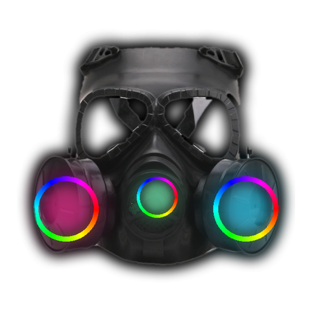
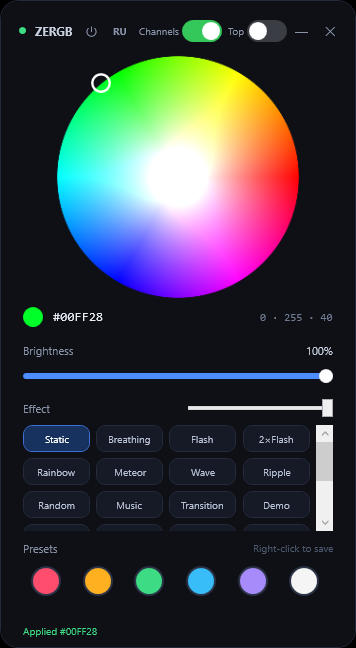

# ZERGB

Настольный виджет для управления RGB-подсветкой корпуса ПК напрямую через
HID-контроллер материнской платы — **без RGB Fusion и других программ
производителя**.

> ⚠️ Приложение разработано с помощью ИИ (AI-assisted).





*[English version](README.md)*

## Возможности

- **Цвет** — цветовой круг, цвет применяется сразу.
- **Яркость** — полоса 0–100 %.
- **Эффекты** — 22 аппаратных режима, считает сам контроллер: статика,
  дыхание, мигание, радуга, метеор, волна, рябь, случайный, переход, демо,
  ритм и другие.
- **Скорость** — ползунок 0–9 (10 градаций таймингов протокола).
- **Музыка** — реакция на системный звук (WASAPI loopback): цвет следует за
  басом/серединой/высокими, яркость — за громкостью.
- **Пресеты** — 6 слотов: ЛКМ применить, ПКМ сохранить.
- **Питание** — кнопка ⏻: выключить/включить подсветку.
- **Поправка каналов** — тумблер в стиле iOS для плат с «перевёрнутыми»
  каналами R/G/B.
- **Поверх всех окон** — тумблер в шапке.
- **Трей** — сворачивание, меню (открыть, поверх окон, поправка каналов,
  автозапуск, выход).
- **Горячие клавиши** (глобальные):
  - `Ctrl+Alt+L` — вкл/выкл подсветку,
  - `Ctrl+Alt+↑` / `Ctrl+Alt+↓` — яркость ±10 %,
  - `Ctrl+Alt+1…9` — первые девять эффектов.
- **Язык** — русский / английский.

## Быстрый старт

1. Скачай **`ZERGB.exe`** (в релизах этого репозитория).
2. Запусти. Ничего устанавливать не нужно — `.NET Framework 4.8` уже есть
   в Windows 10/11.
3. Управляй подсветкой. Повторный запуск поднимает уже открытое окно.

## Требования

- Windows 10/11 (x64).
- Материнская плата с HID-контроллером подсветки ITE `VID_048D&PID_5702`
  (проверено на GIGABYTE B660 GAMING X DDR4). На других платах может
  потребоваться другой путь устройства.
- RGB Fusion **не нужен** и должен быть закрыт — он пишет в тот же контроллер
  и вызывает мерцание.

## Как это работает

Приложение открывает HID-устройство контроллера (`hid.dll`) и отправляет
64-байтные feature-репорты — тот же протокол, что использует RGB Fusion.

Формат пакета (распознан трассировкой обмена с устройством):

```
CC 20 FF 00 00 00 00 00 00 00 00 <режим> <яркость> 00 <B> <G> <R>
CC 28 FF            — применить
CC 21..27           — сброс зон
```

Режимы (`Mode_Sel`): `1` статика, `2` дыхание, `3` мигание, `4` радуга,
`5` метеор, `6` волна, `7` рябь, `8` случайный, `51` двойное мигание,
`52` переход, `53` демо, `56` ритм, `100` SWave, `102` SMeteor,
`103` дрожание, `104` взрыв, `105` возврат, `106` двойной метеор,
`107` стек, `109` дождь, `111` DWave, `112` SWave2.

## Сборка из исходников

Нужно: Windows, `.NET Framework 4.8` (и компилятор `csc.exe` из него),
файлы `NAudio.dll` (в `lib/`) и картинки `wheel.png`, `icon.ico`.

```powershell
.\build.ps1
```

Скрипт соберёт `ZERGB.exe` с встроенными ресурсами (разметка, иконка,
NAudio — всё внутри, итог получается одним файлом).

## Структура репозитория

| Файл | Назначение |
|---|---|
| `ZERGB.exe` | собранное приложение (v1.0.1) |
| `WidgetApp.cs` | весь код (интерфейс, HID, эффекты, музыка) |
| `ui.xaml` | разметка окна |
| `wheel.png` | изображение цветового круга |
| `icon.ico`, `logo.png` | иконка приложения |
| `mask_src.jpg`, `process_mask.py` | исходное фото и скрипт генерации иконки |
| `lib/NAudio.dll` | зависимость для захвата звука (MIT) |
| `build.ps1` | сборка |
| `CHANGELOG.md` | журнал изменений |

## Примечание о SmartScreen

Собранный exe подписан самоподписанным сертификатом. На других машинах
Windows SmartScreen может показать предупреждение «неопознанное приложение» —
нажмите «Подробнее → Выполнить в любом случае». Для «чистого» запуска без
предупреждений нужен сертификат от публичного удостоверяющего центра.

## Лицензия

MIT — см. [LICENSE](LICENSE).
